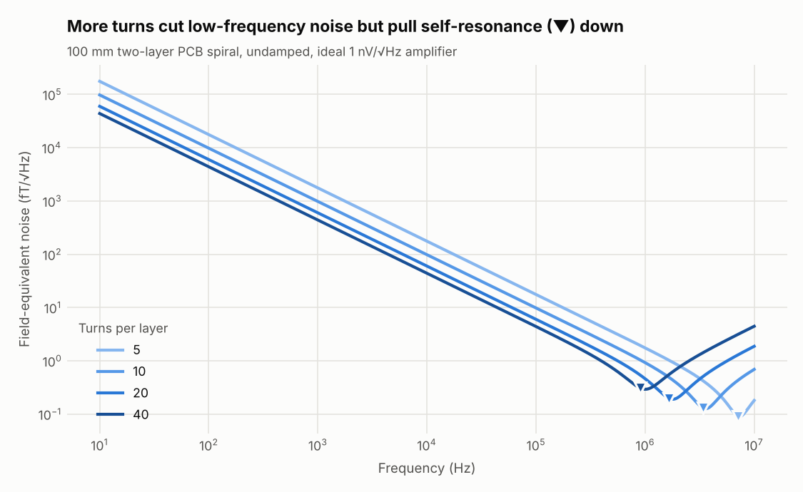
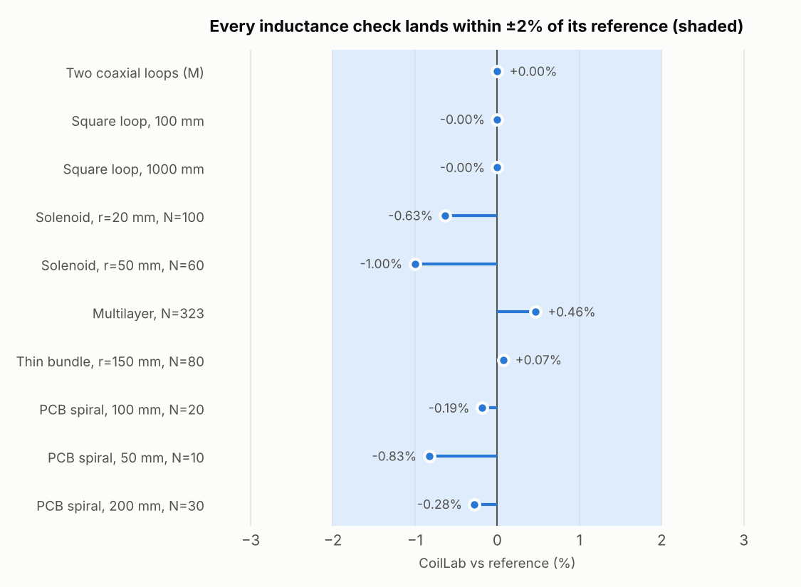

# CoilLab

**Design and analysis of inductive (search-coil) magnetic sensors in Python.**

CoilLab takes a coil's geometry and returns the numbers that decide whether it will work as a magnetic
sensor: resistance, inductance, self-capacitance, self-resonant frequency (SRF), summed turn area,
sensitivity and field-equivalent noise. Every model is checked against independent formulas from the
public literature.



> **Status: v0.1, the forward model.** Optimization, damping networks and robust (tolerance-aware)
> design are on the [roadmap](#roadmap).

## Why

An induction coil senses the time derivative of the magnetic flux through it. More turns and more area
give more signal, but they also add resistance (thermal noise), inductance (roughly N²) and
interwinding capacitance, so the self-resonance slides down toward the band you care about. Finding the
best design means balancing all of these at once, and that's what CoilLab is built to do.

Applications include ELF/VLF receivers, geophysics (magnetotellurics), space-physics search coils,
eddy-current NDT probes and wireless-power or RFID coils.

## Install

```bash
git clone https://github.com/sha-kya/coillab.git
cd coillab
pip install -e ".[plot]"      # or ".[dev]" for tests and linting
```

Requires Python 3.9+, NumPy and SciPy. Matplotlib is optional (for the examples).

## Quick start

```python
from coillab import CircularCoil, PCBSquareSpiral, Amplifier

coil = CircularCoil(radius=0.15, n_turns=80, wire_diameter=0.5e-3, turns_per_layer=10)
report = coil.analyze(freq=1e3, amplifier=Amplifier(en=1e-9, in_=10e-15, c_in=10e-12))
print(report)

pcb = PCBSquareSpiral(outer_side=0.1, turns_per_layer=20, trace_width=0.3e-3,
                      spacing=0.3e-3, n_layers=2)
print(pcb.inductance(), pcb.srf(), pcb.area_sum())
spectrum = pcb.spectrum([10, 100, 1e3, 1e4])   # noise vs frequency
```

Or from the command line (lengths in mm):

```text
$ coillab circular --radius 150 --turns 80 --wire 0.5 --turns-per-layer 10 --freq 1000
Coil               circular, r=150 mm, N=80, 8 layer(s), wire 0.5 mm
Frequency          1 kHz
Turns              80
Wire length        76.35 m
Copper mass        134.3 g
R (DC)             6.704 Ohm
R (AC, skin)       6.704 Ohm
Inductance         5.289 mH
Self-capacitance   195.9 pF
Total capacitance  205.9 pF
Self-resonance     152.5 kHz
Summed turn area   5.799 m^2
Sensitivity        36.43 kV/T
EMF @ 1 nT         36.43 uV
EMF noise          1.053 nV/rtHz
Field noise        28.9 fT/rtHz
```

`coillab square ...` and `coillab pcb ...` work the same way; add `--json` for machine-readable output.

## What it models

| Quantity | Method |
| --- | --- |
| Inductance, circular turns | Maxwell's exact elliptic-integral mutual inductance between every pair of turns, plus the thin-loop self-inductance |
| Inductance, square turns and PCB spirals | Greenhouse method: exact mutual inductance of parallel straight filaments, plus exact straight-wire (round) or Ruehli (rectangular) self terms |
| AC resistance | Exact Bessel-function skin effect for round wire; Yue–Wong approximation for traces |
| Self-capacitance | Energy method over neighbouring turns: parallel-wire, coplanar-strip (conformal mapping) and parallel-plate capacitances, weighted by the voltage between turns |
| Field-equivalent noise | n_B = n_e / (2πf·A_Σ), with coil thermal noise and amplifier voltage and current noise referred to the EMF through the coil's RLC transfer function |

Supported geometries: `CircularCoil` (single-layer solenoid or multilayer bundle), `SquareCoil`
(square loop antenna) and `PCBSquareSpiral` (one or more series-connected copper layers).

## Validation

`python examples/validate.py` regenerates this comparison. Each reference is a *different* method from
the one CoilLab uses, so agreement is a real check.



| Reference | Used for |
| --- | --- |
| Brute-force Neumann integral | Mutual inductance of circular loops |
| F. W. Grover, *Inductance Calculations* | Square loop of round wire |
| H. A. Wheeler, "Simple inductance formulas for radio coils," *Proc. IRE*, 1928 | Single-layer and multilayer coils |
| Maxwell's ring formula with the winding's geometric mean distance | Thin multilayer bundles |
| S. S. Mohan *et al.*, "Simple accurate expressions for planar spiral inductances," *IEEE JSSC*, 1999 | Square PCB spirals |

Full table: [docs/validation.md](docs/validation.md). Run the test suite with `pytest`.

## Limitations (v0.1)

- **Self-capacitance is first-order.** Only nearest-neighbour turns are included. For an accurate SRF,
  measure one coil and set `capacitance_scale` to match.
- **No proximity effect.** AC resistance includes skin effect only, so it's optimistic for densely
  wound coils at high frequency.
- **No damping network yet.** The noise spectrum shows the undamped resonance, which is why the curves
  above dip at the SRF. Real receivers damp it (v0.2).
- **Uniform field.** Sensitivity assumes a uniform field normal to the turns.

## Roadmap

1. **v0.1, forward model** (this release): R, L, C, A_Σ, SRF and noise for three geometries, validated.
2. **v0.2, front end:** passive and active damping with automatic damping-ratio tuning; gain and phase.
3. **v0.3, optimizer:** multi-objective search (pymoo NSGA-II) over geometry and damping; site
   background-noise models; Pareto fronts of noise vs SRF vs size.
4. **v0.4, robust mode:** Monte Carlo over component and build tolerances; phase-spec yield.
5. **v0.5, verification and UI:** ngspice netlist export and overlay checks, FastHenry cross-checks,
   and a Streamlit app.

## Project layout

```text
src/coillab/
  coils.py        geometries, equivalent circuit, CoilReport
  inductance.py   Maxwell and Greenhouse inductance
  resistance.py   DC and skin-effect resistance
  capacitance.py  energy-method self-capacitance
  references.py   independent closed-form references (validation only)
  cli.py          command-line interface
examples/         validation and trade-off scripts
tests/            pytest suite
```

## License

MIT
