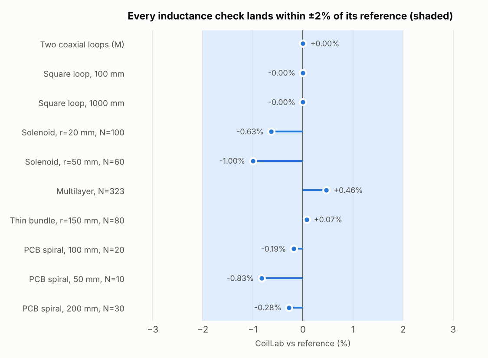

# Validation

Generated by `examples/validate.py`. Each row compares CoilLab's inductance model with an independent method from the public literature.

| Case | Reference | CoilLab | Reference value | Difference |
| --- | --- | --- | --- | --- |
| Two coaxial loops (M) | Brute-force Neumann integral | 171.9 nH | 171.9 nH | +0.00% |
| Square loop, 100 mm | Grover | 382.3 nH | 382.3 nH | -0.00% |
| Square loop, 1000 mm | Grover | 6.216 uH | 6.216 uH | -0.00% |
| Solenoid, r=20 mm, N=100 | Wheeler single-layer | 217.3 uH | 218.7 uH | -0.63% |
| Solenoid, r=50 mm, N=60 | Wheeler single-layer | 326.6 uH | 329.9 uH | -1.00% |
| Multilayer, N=323 | Wheeler multilayer | 5.557 mH | 5.531 mH | +0.46% |
| Thin bundle, r=150 mm, N=80 | Maxwell ring with GMD | 5.289 mH | 5.285 mH | +0.07% |
| PCB spiral, 100 mm, N=20 | Mohan et al. current sheet | 78.06 uH | 78.21 uH | -0.19% |
| PCB spiral, 50 mm, N=10 | Mohan et al. current sheet | 8.58 uH | 8.652 uH | -0.83% |
| PCB spiral, 200 mm, N=30 | Mohan et al. current sheet | 227.3 uH | 227.9 uH | -0.28% |

